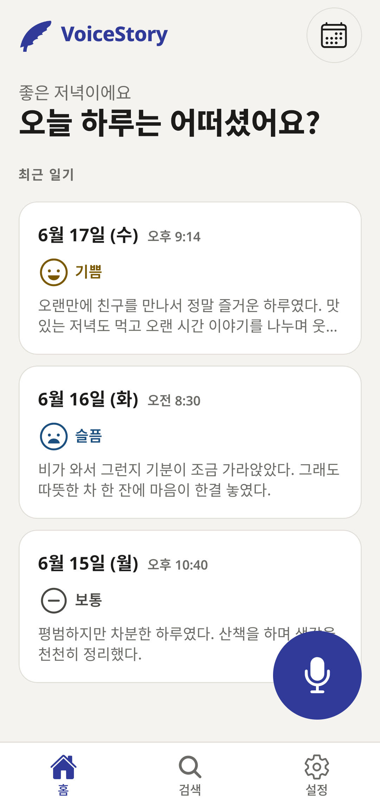
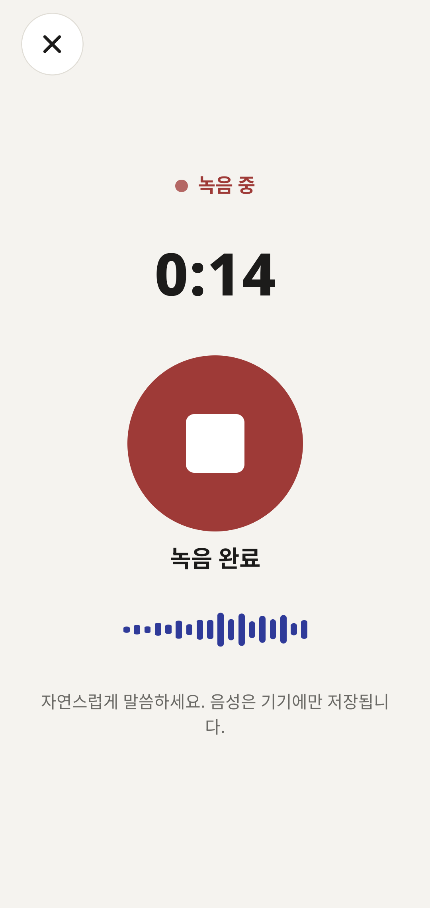
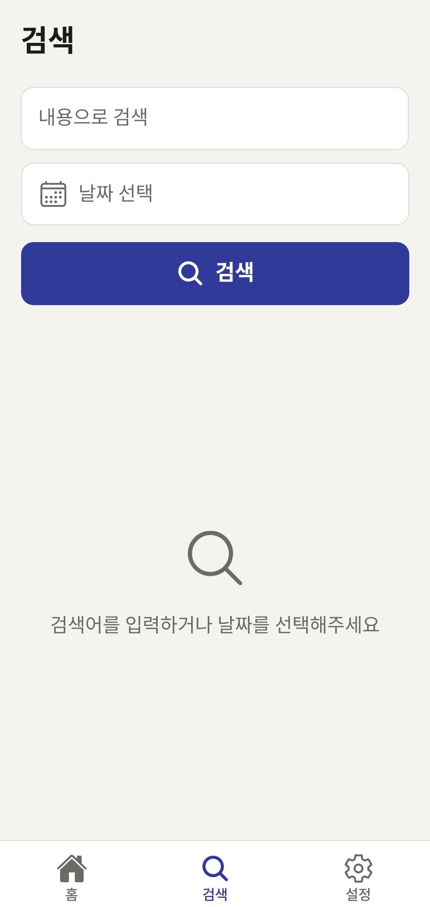

<h1 align="center">
  VoiceStory
</h1>

  
   
   
  목소리로 남기는 오늘의 이야기

 

  
  &nbsp;
  

## 소개

**VoiceStory**는 시각장애인을 위한 음성 일기 앱입니다. 
오늘 있었던 일을 이야기하면 음성을 글로 바꾸고, 그날의 감정과 함께 저장할 수 있습니다. 
온디바이스 AI가 인식된 글의 오타를 교정하고 감정을 추천하며, 저장한 일기는 글과 목소리로 다시 돌아볼 수 있습니다.

 

## 주요 기능

- **음성 일기**: 말한 내용을 글로 변환하고, 녹음 파일과 함께 저장합니다.
- **AI 교정과 감정 추천**: 기기에서 실행하는 AI로 오타를 교정하고, 일기에 어울리는 감정을 추천받습니다.
- **일기 조회와 검색**: 날짜와 내용으로 지난 일기를 찾고, 녹음한 목소리를 다시 들을 수 있습니다.
- **알림과 위젯**: 원하는 시간에 일기 알림을 받고, 홈 화면 위젯에서 녹음 화면을 열 수 있습니다.
- **백업과 복원**: 일기와 녹음을 하나의 파일로 내보내고 다시 가져올 수 있습니다.
- **접근성과 다국어**: VoiceOver·TalkBack, 햅틱 피드백과 한국어·영어·일본어·중국어 간체·번체를 지원합니다.

<table>
  <tr>
    <td align="center"></td>
    <td align="center"></td>
    <td align="center"></td>
  </tr>
  <tr>
    <td align="center"><b>일기 목록</b></td>
    <td align="center"><b>음성 녹음</b></td>
    <td align="center"><b>일기 검색</b></td>
  </tr>
</table>

## 기여자

<table>
  <tr>
    <td align="center">
      
    </td>
  </tr>
  <tr>
    <td align="center">
      <a href="https://github.com/hugesilver">hugesilver</a>
    </td>
  </tr>
</table>

## 기술 스택

    

## 라이브러리

- [expo-speech-recognition](https://github.com/jamsch/expo-speech-recognition): 음성을 텍스트로 변환
- [React Native ExecuTorch](https://github.com/software-mansion/react-native-executorch): Qwen3 1.7B 모델을 이용한 온디바이스 오타 교정·감정 추천
- [Expo Resource Fetcher](https://github.com/software-mansion/react-native-executorch/tree/main/packages/expo-resource-fetcher): AI 모델 다운로드·관리
- [expo-sqlite](https://github.com/expo/expo/tree/main/packages/expo-sqlite): 일기 저장·검색
- [AsyncStorage](https://github.com/react-native-async-storage/async-storage): 앱 설정 저장
- [react-native-android-widget](https://github.com/sAleksovski/react-native-android-widget): Android 홈 화면 위젯
- [react-native-zip-archive](https://github.com/mockingbot/react-native-zip-archive): 백업 파일 압축·해제
- [i18next](https://github.com/i18next/i18next), [react-i18next](https://github.com/i18next/react-i18next): 다국어 지원
